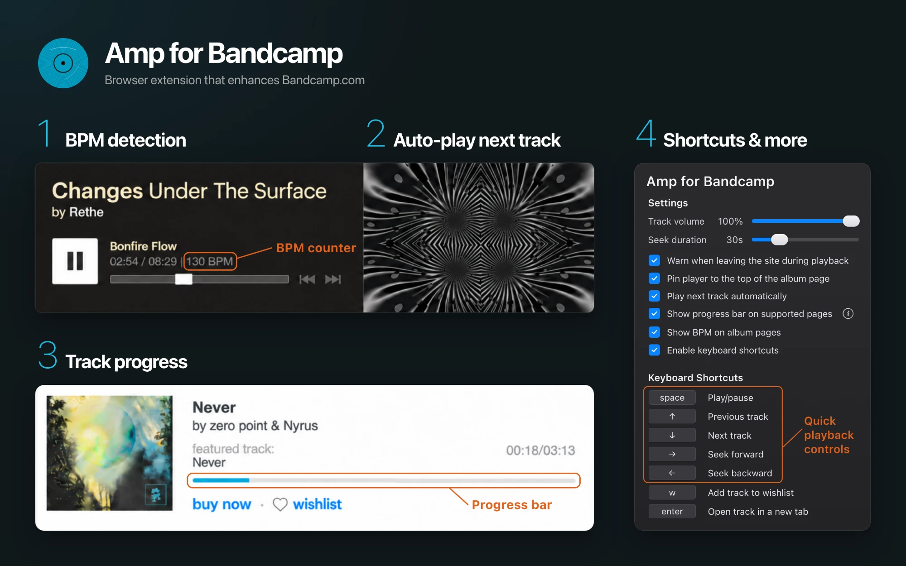

# Amp for Bandcamp

A browser extension for Chrome, Firefox and Safari that enhances [Bandcamp.com](https://bandcamp.com) with BPM detection, auto-play, track progress, keyboard shortcuts and more.

<a href="https://apps.apple.com/pl/app/amp-for-bandcamp/id6745343456"></a>
<a href="https://chromewebstore.google.com/detail/amp-for-bandcamp/gjmlgkbcolbleloakpcfhfaodldlheld"></a>
<a href="https://addons.mozilla.org/en-US/firefox/addon/amp-for-bandcamp/"></a>



> **Disclaimer**: This extension is not affiliated with, endorsed by, or connected to Bandcamp. It is an independent project designed to enhance the user experience on Bandcamp.

## Features

- **BPM detection** – shows the tempo of the playing track next to its time on album pages, analysed in the background
- **Auto-play next track** – keeps the music going when a track ends, on the feed and collection pages and for related tracks on album pages
- **Track progress** – adds a progress bar to tracks playing in the feed and to related tracks on album pages
- **Keyboard shortcuts** – control playback without reaching for the mouse (see [below](#keyboard-shortcuts))
- **Volume and mute** – one volume slider and mute toggle for every page, kept in sync with Bandcamp's own sliders; the toolbar icon shows when sound is off
- **Sticky player** – pins the player to the top of album pages while you scroll
- **Leave warning** – asks before you navigate away from the site during playback

Everything is configured from the extension popup.

### Keyboard shortcuts

| Key | Action |
| --- | --- |
| <kbd>Space</kbd> | Play/pause |
| <kbd>↑</kbd> | Previous track |
| <kbd>↓</kbd> | Next track |
| <kbd>→</kbd> | Seek forward |
| <kbd>←</kbd> | Seek backward |
| <kbd>W</kbd> | Add track to wishlist |
| <kbd>Enter</kbd> | Open track in a new tab |

The seek duration is configurable from 5 to 120 seconds (30 by default). The keyboard's media keys for play/pause and next/previous track work too. Shortcuts are available on album and track pages, the feed, collection, discover, the homepage player and live listening pages.

## Development and building

Built with [WXT](https://wxt.dev/), TypeScript, and React. WXT generates the browser manifests and bundles the extension; the popup is a React app, and the content script contains the Bandcamp page controllers.

### Prerequisites

- Node.js 22.12 or newer and npm
- Xcode for the native Safari app

```bash
npm ci

# Start development with automatic rebuilds and browser reloads
npm run dev
npm run dev -- -b firefox     # Optional: develop in Firefox

# Check TypeScript
npm run compile

# Build Chrome/Edge/Opera, Firefox, and Safari together
npm run build

# Package for distribution
npm run build:zip             # Chrome and Firefox ZIPs in .output/
npm run build:safari          # Safari web build + native app in dist/safari
npm run build:all             # Both ZIPs + native Safari app
```

`npm run build` generates `.output/chrome-mv3`, `.output/firefox-mv3`, and `.output/safari-mv3` from the same source code. Browser-specific manifests are generated automatically. All targets use Manifest V3. Extension metadata and permissions live in `wxt.config.ts`; the version comes from `package.json`. Icons live in `public/icons`. Entrypoints are in `src/entrypoints`, with shared playback controllers in `src/content-pages`.

The Safari Xcode targets copy the compiled `.output/safari-mv3` contents into their extension resources. Run `npm run build:safari:web` after changing web code and before building directly in Xcode. Both macOS and iOS targets use that output.

BPM analysis downloads audio in the extension background and streams small chunks to a hidden extension page for decoding. Downloads stay in the background because Safari applies CORS restrictions to embedded extension pages. Beat detection runs in a packaged Web Worker, and only the BPM result is sent to the album page. This uses the same implementation for Chrome, Firefox, and Safari without Chrome-only offscreen APIs. Switching tracks or disabling BPM removes the analysis frame and cancels the download; completed results are cached for the album page's lifetime.

## Installation (from sources)

After finishing the "build" step from the above, you can now proceed to the installation step.

### Chrome/Edge/Opera
1. Download or clone this repository
2. Open Chrome and navigate to `chrome://extensions/`
3. Enable "Developer mode" (toggle in the top-right corner)
4. Click "Load unpacked" and select `.output/chrome-mv3`
5. The extension should now be installed and active

### Firefox
1. Download or clone this repository
2. Open Firefox and navigate to `about:debugging#/runtime/this-firefox`
3. Click "Load Temporary Add-on..."
4. Select `.output/firefox-mv3/manifest.json`
5. The extension should now be installed and active (note: this is temporary and will be removed when Firefox is closed)

### Safari
1. Download or clone this repository
2. Install Xcode from the Mac App Store
3. Run `npm ci` and `npm run build:safari:web`, then open the Xcode project:
   ```bash
   open "safari/Amp for Bandcamp.xcodeproj"
   ```
4. Build and run the project in Xcode
5. Enable the extension in Safari preferences:
   - Safari > Settings > Extensions
   - Check the box next to "Amp for Bandcamp"

## Testing

The extension uses [Playwright](https://playwright.dev/) for end-to-end testing. The local tests serve small HTML fixtures that mimic Bandcamp's album, feed, collection, discover, home and live pages, so they run offline. They cover keyboard shortcuts, seeking, volume, auto-play, progress bars, the sticky player, leave warnings, popup settings, BPM detection and the background audio download. The album, collection, discover and homepage smoke tests also visit real Bandcamp pages and require network access.

### Security and performance

Two files check things the feature tests do not:

- [`tests/Security.spec.ts`](tests/Security.spec.ts) reads each build's manifest and files: the only permissions are storage and the Bandcamp hosts, and no script is remote, inline or built at run time. It then plays a hostile page against the extension: a forged BPM result, a track URL that only mentions `bcbits.com`, another site embedding the BPM analyzer, CSS smuggled into the page's colour data, and seek or volume requests from an embedded frame or out of range. [`tests/Background.spec.ts`](tests/Background.spec.ts) covers which audio URLs the background script will download, and for whom.
- [`tests/Performance.spec.ts`](tests/Performance.spec.ts) holds each build to size budgets, and checks that a 2,000-track album is set up soon after it is parsed, that a page adding thousands of elements is not slowed much (compared with the same page without a player, so the result does not depend on the machine), that changing settings repeatedly leaves a single auto-play timer, and that the popup opens quickly. [`tests/Bpm.spec.ts`](tests/Bpm.spec.ts) checks that analyzing a 32 MB track never blocks the album page.

Both run with the local tests, in every browser. The budgets are loose on purpose: they catch a jump, not a few percent.

```bash
npm run test:security
npm run test:performance

# Known vulnerabilities in the packages that ship in the extension (needs network)
npm run test:audit
```

### Browsers

On your machine the tests run in Chromium only. GitHub Actions runs them in Chromium, Firefox and WebKit. To run another browser locally, name it in `TEST_BROWSERS`:

```bash
npx playwright install firefox webkit
TEST_BROWSERS=firefox,webkit npm test
```

Playwright can only load an extension into Chromium, so each browser gets it in its own way (see [`tests/browsers`](tests/browsers)):

| Browser | Build | How the tests load it |
| --- | --- | --- |
| Chromium | `.output/chrome-mv3` | As an unpacked extension. |
| Firefox | `.output/firefox-mv3` | As a temporary add-on, installed over Firefox's remote debugging protocol. Extension pages open in a frame, and a local proxy answers the background script's audio downloads. |
| WebKit | `.output/safari-mv3` | Not as an extension. The Safari build's content script, popup and background script run in Safari's engine, with a stand-in for the extension APIs they use. |

The WebKit run finds code that Safari's engine runs differently. It cannot find a difference in Safari's own extension APIs.

### Install Playwright Dependencies
```bash
npx playwright install chromium
```

### Running Tests

```bash
# Build and run all tests
npm test

# Run the local integration tests without depending on Bandcamp
npm run test:local

# Run tests with interactive UI
npm run test:ui

# Run tests in debug mode
npm run test:debug
```

### Testing in Safari

`npm run test:safari` loads the Safari build into Safari itself through `safaridriver` and checks that the content script runs, that Space toggles playback and that a volume change in the popup reaches the page. GitHub Actions runs it in its own job. It is a single script, [`tests/safari/smoke.mjs`](tests/safari/smoke.mjs), because Playwright cannot drive Safari.

To run it on your Mac you need Safari 26 or later with "Allow remote automation" turned on (Safari Settings, Developer). Safari opens a window while the test runs. If the session times out while connecting to Safari, quit Safari and run the test again. The test page is served locally as `amp-test.bandcamp.com`, which needs a line in `/etc/hosts`:

```bash
echo '127.0.0.1 amp-test.bandcamp.com' | sudo tee -a /etc/hosts
```

`SAFARI_LIVE=1 npm run test:safari` visits a real Bandcamp album instead and needs no hosts entry.

The test loads a copy of the build with a few lines added to the background script, because of two limits of an automated Safari window:

- Safari gives an extension no access to a site until the user allows it. In an automated window Safari only offers that access once the background script asks about the tab, so the copy asks. Safari may then show its access prompt, which stops the test until it is answered. On GitHub Actions the test presses "Always Allow" itself (`SAFARI_ANSWER_PROMPT=1`, which needs the Accessibility permission the runners have); on your Mac, press it yourself if it appears.
- Safari refuses to open the popup's `safari-web-extension://` URL directly, so the copy opens the popup in a tab.

The popup as a real toolbar popup is therefore not tested, and a release still needs a look at that in Safari. When the test fails on GitHub Actions, the job keeps a screenshot and `safaridriver`'s log as the `safari-failure` artifact.

## Releasing

Releases are made by the [Release workflow](.github/workflows/release.yml). Start it by hand from the repository's Actions tab ("Run workflow"). It then:

1. runs the whole test suite and signs in to each store without uploading anything, and stops if a test fails or a store rejects its secrets;
2. lets [semantic-release](https://semantic-release.gitbook.io/) read the commits since the last `v*` tag and pick the next version;
3. writes that version into `package.json` and the Xcode project, builds the store zips, commits the version bump, tags it and publishes a GitHub release with the zips attached;
4. submits that version to the Chrome Web Store, Firefox Add-ons and the Mac App Store, each in its own job. For the Mac App Store, Xcode Cloud builds and uploads the app; the job waits for that build, uploads the listing and submits it.

Tick "Only show which version would be released" to see what a run would do without releasing anything. A dry run still signs in to each store, so it is also the way to check the secrets after adding or changing them. If one store fails, use "Re-run failed jobs" on the run: the version is not released a second time. A store whose secrets are not set is skipped with a warning. Each store still reviews the submission on its own schedule.

### Commit messages

The version number comes from the commit messages, which follow [Conventional Commits](https://www.conventionalcommits.org/):

| Commit | Release |
| --- | --- |
| `fix: ...`, `perf: ...` | patch (2.0.1 → 2.0.2) |
| `feat: ...` | minor (2.0.1 → 2.1.0) |
| a `BREAKING CHANGE:` footer, or `feat!: ...` | major (2.0.1 → 3.0.0) |
| `chore:`, `docs:`, `test:`, `ci:`, `refactor:`, `style:`, `build:` | none |

A commit that does not follow the format is ignored by the release, so a `commit-msg` hook (installed by `npm install`) rejects it, and the "Commit messages" workflow checks pushes and pull requests. The `feat` and `fix` subjects become the release notes, and the "What's New" text on the App Store, so write them for users.

### One-time setup

semantic-release counts from the last tag, so tag the commit of the last published version, 2.0.0, once:

```bash
git tag v2.0.0 <commit that was published as 2.0.0>
git push origin v2.0.0
```

Commits before that tag are never looked at. Commits made after it without the format are ignored too, so changes that were made that way and are not released yet need one empty commit each to announce them, for example:

```bash
git commit --allow-empty -m "feat: add a mute button"
```

In Xcode Cloud, set the workflow's start condition to tag changes matching `v*` (instead of branch changes), with an Archive action for the macOS scheme and App Store Connect distribution. Pushing the release tag then starts the build of exactly that version.

Then add the secrets of each store under Settings → Secrets and variables → Actions:

| Store | Secrets | Where they come from |
| --- | --- | --- |
| Chrome Web Store | `CHROME_PUBLISHER_ID`, `CHROME_SERVICE_ACCOUNT_CLIENT_EMAIL`, `CHROME_SERVICE_ACCOUNT_PRIVATE_KEY` | Enable the Chrome Web Store API in a Google Cloud project, create a service account with a JSON key there, and add the service account's email under Account in the Chrome Web Store developer dashboard. The publisher ID is on the same page; the email and private key are the `client_email` and `private_key` values of the JSON key. |
| Firefox Add-ons | `FIREFOX_JWT_ISSUER`, `FIREFOX_JWT_SECRET` | [addons.mozilla.org → Tools → Manage API Keys](https://addons.mozilla.org/developers/addon/api/key/). The add-on must already be listed. |
| Mac App Store | `APP_STORE_CONNECT_KEY_ID`, `APP_STORE_CONNECT_ISSUER_ID`, `APP_STORE_CONNECT_KEY` | App Store Connect → Users and Access → Integrations → App Store Connect API. Create a team key with the App Manager role. The key is the whole content of the downloaded `.p8` file. |

Running `npx wxt submit init` walks through the Chrome and Firefox values.

### Changing the App Store listing

The App Store listing is kept in the repository and uploaded with every release by [fastlane](https://fastlane.tools) ([`fastlane/Fastfile`](fastlane/Fastfile)). Download the current listing once, signing in with your Apple ID:

```bash
bundle install
bundle exec fastlane deliver download_metadata --platform osx -u <your Apple ID>
bundle exec fastlane deliver download_screenshots --platform osx -u <your Apple ID>
```

This fills `fastlane/metadata/<language>/` with one text file per field (`description.txt`, `keywords.txt`, `promotional_text.txt`...) and `fastlane/screenshots/<language>/` with the images. Commit them. To change the description or a screenshot, edit or replace the file and commit it; the next release uploads it. A field or screenshot folder that is not in the repository is left as it is on App Store Connect.

Apple ties the listing to a version, so a change to the listing alone still needs a release. Commit it as a fix, for example `fix(store): update the screenshots`, and run the Release workflow.

To check the listing in App Store Connect before it goes to review, set the repository variable `APPLE_SUBMIT_FOR_REVIEW` to `false`. The workflow then uploads the listing, attaches the build and leaves "Submit for Review" to you.

The Chrome Web Store and Firefox Add-ons listings are not tied to a version: edit them in each store's developer dashboard at any time.

## Safari releases with Xcode Cloud

The executable hook [`safari/ci_scripts/ci_post_clone.sh`](safari/ci_scripts/ci_post_clone.sh) lives alongside `safari/Amp for Bandcamp.xcodeproj`, where [Xcode Cloud discovers custom build scripts](https://developer.apple.com/documentation/xcode/writing-custom-build-scripts).

After checkout, the hook ensures Node.js 22.12 or newer is available (installing Node 22 with Homebrew if needed), installs the locked npm dependencies with `npm ci`, checks TypeScript, and builds only the Safari web extension into `.output/safari-mv3`. Any failed step stops the build. The existing Xcode build phases then copy the generated manifest, JavaScript, CSS, and icons into the macOS or iOS Safari extension during the native build/archive.

In Xcode Cloud, configure the Safari project's workflow with a tag-change start condition for `v*` tags, which the [Release workflow](#releasing) pushes, and an Archive action for the appropriate app scheme. Configure signing and the desired App Store Connect/TestFlight distribution in that workflow. Commit and push the hook with the project changes; Xcode Cloud runs it automatically on subsequent builds. The hook prepares the web assets; Xcode Cloud handles the native archive and distribution.

## GitHub Actions CI

`npm run ci` checks TypeScript, builds all three browser bundles, and runs the local integration tests. BPM tests use synthetic audio to check detection, responsiveness, cancellation, caching, and error cleanup. The GitHub Actions workflow runs this command in three jobs, one each for Chromium, Firefox and WebKit, after installing npm dependencies and that job's Playwright browser. A separate job runs `npm run test:audit`.

`npm run test:live` runs the separate smoke tests against the real Bandcamp album, collection, discover and home pages. `npm test` runs all tests. These tests dismiss Bandcamp’s cookie dialog before checking playback and require access to the live site; offline CI runs the local integration tests.
